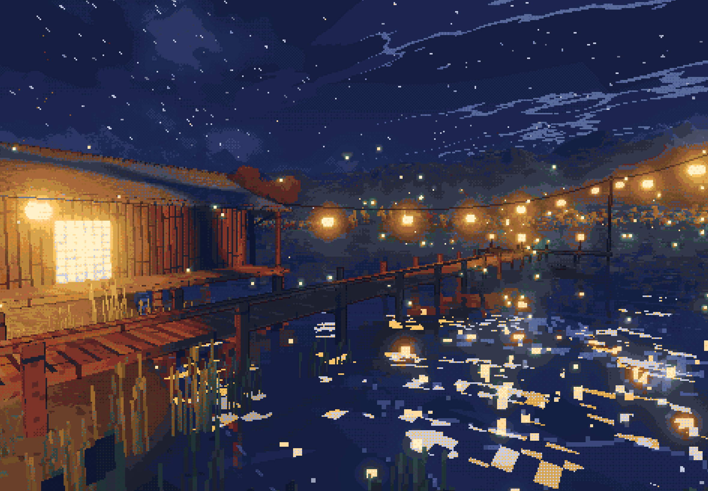
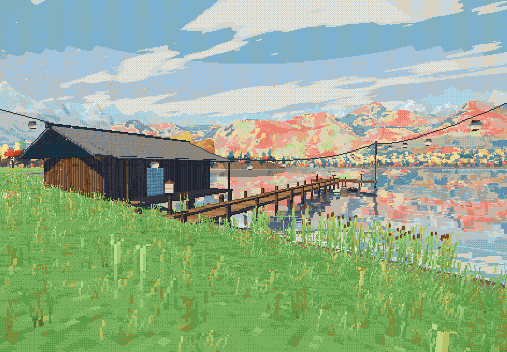
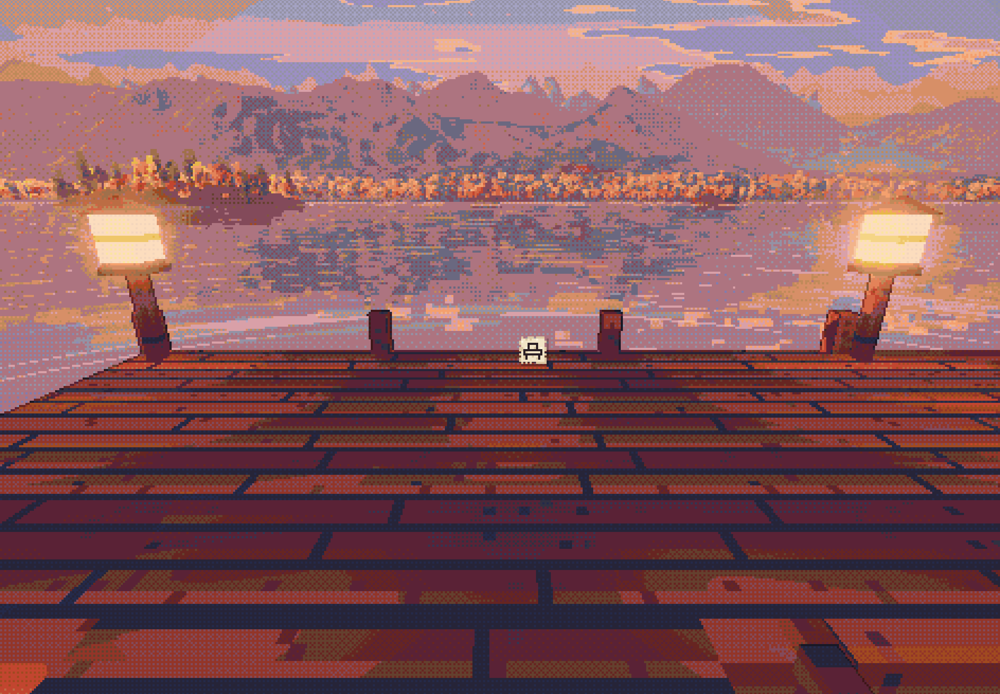
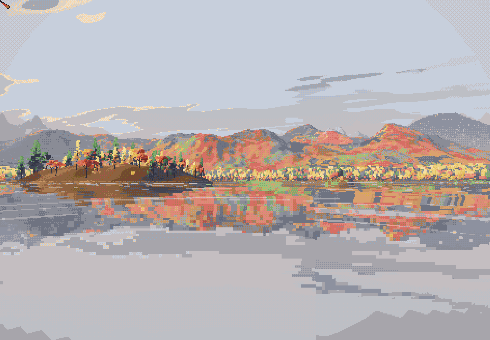
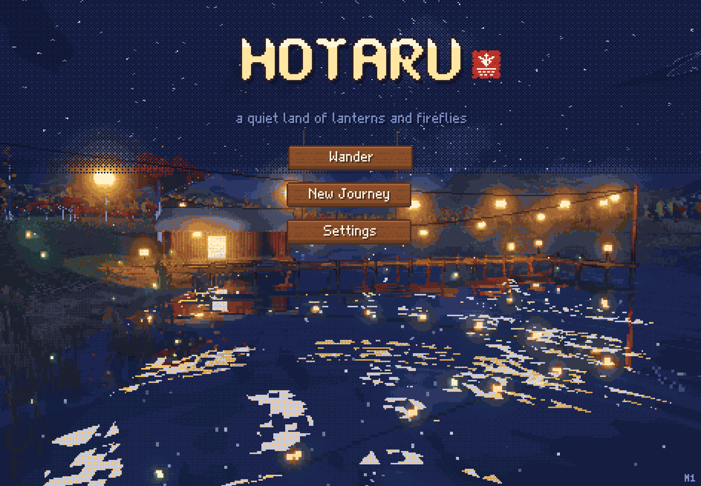

# HOTARU

A quiet, fully 3D, first-person Japanese-inspired exploration game rendered as a
living pixel-art painting. Runs offline on iPad as a PWA.

- Design & tech spec: [`SPEC.md`](SPEC.md)
- Plan, tech choices & risks: [`PLAN.md`](PLAN.md)
- Decision log: [`DECISIONS.md`](DECISIONS.md)
- Reference look: [`reference/`](reference/)

## Status

| # | Milestone | Status | Screenshots | iPad benchmark (Medium) |
|---|---|---|---|---|
| M1 | Foundations & THE LOOK prototype | ✅ Done | [M1](docs/screenshots/M1/) | pending (run on iPad) |
| M2 | Terrain & world streaming | ✅ Done | [M2](docs/screenshots/M2/) | pending (run on iPad) |
| M3 | Player controller & controls | ✅ Done | [M3](docs/screenshots/M3/) | pending (run on iPad) |
| M4 | Water | ⬜ Not started | — | — |
| M5 | Vegetation, wind & particles | ✅ Done | [M5](docs/screenshots/M5/) | pending (run on iPad) |
| M6 | Regions, weather & seasons | ⬜ Not started | — | — |
| M7 | Buildings, villages & interiors | 🔨 In progress | — | — |
| M8 | Fauna | ⬜ Not started | — | — |
| M9 | Villagers & wanderers | ⬜ Not started | — | — |
| M10 | Castle, shrines, caves & secrets | ⬜ Not started | — | — |
| M11 | Items, journal, map, photo, boats, fishing | ⬜ Not started | — | — |
| M12 | Lore, spirits & festivals | ⬜ Not started | — | — |
| M13 | Audio | ✅ Done | [M13](docs/screenshots/M13/) · [listen](docs/audio/) | pending (run on iPad) |
| M14 | Polish, performance & release | ⬜ Not started | — | — |

Build order (owner's revision): M2 → M3 → M5 → M13 → M7 → M8 → M4 → M6 → M9 → M10 → M11 → M12 → M14.

Legend: ⬜ not started · 🔨 in progress · 👀 waiting for review · ✅ done

### M13 at a glance (audio)

Everything you hear is synthesised in the browser: no sound files.

- **Music** comes now and then, like in Minecraft: a generated piece of 2–4 minutes, then long
  stretches of just the world. Koto, shakuhachi, shamisen, soft piano, music box, pads and bells
  on Japanese scales. Each region has its own motif, and the Lantern Lake theme comes back in
  variations.
- **Ambience** follows the place, the hour and the wind:
  - dawn chorus in the woods (bush warbler, tits, doves, woodpeckers)
  - creaking cedars, dripping leaves and bamboo knocks in the deep forests
  - crickets, bell crickets, frogs and owls at night
  - gulls and surf at the coast
  - a wind chime at the dock, the temple bell at 6 and 18 h
- **Sound is placed in 3D** around your head, with reverb that changes between forest, valley
  and open land.
- **Footsteps** change with the ground: grass, dry leaves, wood boards, gravel, sand, snow and
  shallow water.
- **Settings → Sound** has volume sliders and how often music plays (often / occasional /
  rare / off).

Listen (rendered offline from the game's own synths):
[main theme](docs/audio/main-theme-title.wav) ·
[cedar forest](docs/audio/cedar-forest-day.wav) ·
[rice valley](docs/audio/rice-valley-day.wav) ·
[lake at night](docs/audio/lake-night.wav)

| Check | Result |
|---|---|
| Unit tests | ✅ 41 passed (composer: determinism, 2–4 min arcs, notes in scale, main theme, sparse nights) |
| Audio e2e (`npm run e2e:audio`) | ✅ unlock on first tap, real output level, music plays, and each of 6 places gets its own mix (forest reverb, surf at the coast, dawn chorus, night insects/frogs, bamboo) |


### M5 at a glance

Grass everywhere: 16 kinds of ground plants (tufts, tall grass, reeds, cattails, ferns, moss,
sasa, pampas, rice, clover, cosmos, spider lilies, bellflowers, dandelions, daisies, horsetail)
stream around you in one draw call, bend in the wind and part as you walk through. Nine new
trees and bushes (willow, persimmon, camphor, hinoki, plum, zelkova, azalea, hydrangea,
camellia), twice-as-dense cedar and bamboo woods, ground mist, and ambient particles —
fireflies, falling leaves, petals, pollen, sun motes, sea spray, moths, steam (rain and snow
are ready for the weather in M6).

| Misty cedar forest | Fireflies at the dock |
|---|---|
|  |  |
| **The pampas moor** | **Bamboo grove** |
|  |  |
| **Meadow by the dock** | **Cosmos fields** |
|  |  |

| Check | Result |
|---|---|
| Unit tests | ✅ 36 passed (incl. ground-plant determinism and tile bounds) |
| Offline · pixel stability · controls e2e | ✅ · ✅ (one-pixel turn match 0.979) · ✅ |
| Draw calls · triangles (headless, all passes) | Low 251 · 1.23 M — Medium 303 · 1.59 M — High 360 · 1.93 M |

Medium is slightly over the 1.5 M triangle budget because of the denser forests; the iPad
benchmark decides whether the far-tree LOD needs trimming.

### M3 at a glance

Walk, jog, slow walk, jump, step up onto ledges, wade, swim (calm, no drowning), slide on snow,
sit and lie down anywhere, time-lapse while sitting, soft landings. Desktop, touch, gamepad and
**Apple Pencil** (tap = look there & interact, drag = precise look, pixel brush cursor);
every key rebindable; FOV, sensitivity, invert Y, head bob, tap-to-jog.

| On the pier (interact prompt) | Sitting at dusk |
|---|---|
|  |  |
| **Swimming** | **Touch controls** |
|  |  |

| Check | Result |
|---|---|
| Unit tests | ✅ 33 passed |
| Controls e2e (`npm run e2e:controls`) | ✅ walk, jump & land, swim, sit, time-lapse, stand up, colliders, Apple Pencil tap |
| Offline / pixel stability | ✅ / ✅ (one-pixel turn match 0.98 after the water-mesh fix) |
| Draw calls · triangles (Medium, all passes) | 278 · 1.54 M |

### M2 at a glance

A 10 km world (16 km with the border ranges) streamed around the player: 20 regions from
the spec, a quadtree terrain built in Web Workers, forests streamed in tiles, and only what
is visible gets drawn.

| Lantern Lake from the castle mountain | Mirror lake at dusk |
|---|---|
|  |  |
| **Maple mountains, golden hour** | **High over the world** |
|  |  |

| Check | Result |
|---|---|
| Unit tests | ✅ 33 passed (incl. chunk-hash determinism, tree placement) |
| Offline boot + save load | ✅ |
| Pixel stability | ✅ |
| Draw calls (headless benchmark path, all passes) | Low 232 · Medium 278 · High 352 (budget < 400) |
| Triangles (all passes: shadow + reflection + main) | Low 1.22 M · Medium 1.54 M · High 1.91 M |
| Download size | 853 KB |
| iPad benchmark | ⏳ needs a run on the iPad |

### M1 at a glance

| Night dock (reference 1) | Mirror lake at dusk (reference 2) |
|---|---|
|  |  |
| **Title screen** | **On the pier (touch HUD)** |
|  |  |

M1 checks:

| Check | Result |
|---|---|
| Type-check + build | ✅ |
| Unit tests (`npm test`) | ✅ 29 passed |
| Offline boot + save load (`npm run e2e:offline`) | ✅ |
| Pixel stability (`npm run e2e:stability`) | ✅ sub-pixel turn: 0 changed pixels |
| Console errors in screenshot runs | ✅ none |
| Download size (precache) | 813 KB |
| Headless perf (software GL, regression only) | see below |
| iPad Air benchmark | ⏳ needs a run on the iPad |

Headless software-rendered numbers (SwiftShader, 2360×1640, *not* representative of a GPU):

| Preset | Internal res (1180×820 viewport) | Avg frame | 1 % low | Draw calls | Triangles (all passes) |
|---|---|---|---|---|---|
| Low | 394×274 ×3 | 789 ms | 883 ms | 101 | 855 k |
| Medium | 590×410 ×2 | 926 ms | 1017 ms | 101 | 855 k |
| High | 590×410 ×2 | 1086 ms | 1300 ms | 101 | 855 k |

Triangles and draw calls are the meaningful numbers here (budget: < 400 draws, < 1.5 M
triangles); frame times need the iPad run.

## Install on iPad (works offline)

1. One-time setup (repo owner): make the repository public, then
   *Settings → Pages → Source: GitHub Actions*. Every push to `main` deploys.
2. On the iPad, open **https://thetaminolutz.github.io/hotaru/** in Safari once.
3. Tap **Share → Add to Home Screen**.
4. Start Hotaru from the home screen. Everything is cached; airplane mode works.
   When a new version has been downloaded, a small paper toast offers a restart.

## Controls

| | Desktop | iPad |
|---|---|---|
| | Desktop | iPad (touch) | Apple Pencil | Gamepad |
|---|---|---|---|---|
| Look | click, then mouse | drag on the right side | drag (fine) | right stick |
| Walk / jog / slow | WASD · Shift · Ctrl/C | koi stick (rim = jog, gentle = slow) | — | left stick · L3/RT · LB/LT |
| Jump | Space | jump token | — | A |
| Interact · sit · lie · stand | E | interact token | tap the thing (also turns your view) | X / B |
| Time-lapse (while sitting) | hold T | hold the hourglass token | — | hold Y |
| Menu | Esc | lacquer token, top right | — | Start |
| Debug panel | `` ` `` | three-finger tap | — | — |

All keys can be rebound in Settings → Keys. Rowing arrives with boats in M11.

## Benchmark on the iPad

Open the debug panel (three-finger tap) → **Benchmark (current preset)** (60 s) or
**All presets** (3 min). Copy the result line and paste it back; it goes into the table above.

## Development

```sh
npm ci
npm run dev            # http://localhost:5173  (?debug=1 opens the debug panel)
npm test               # unit tests (Vitest)
npm run build          # production build + service worker in dist/
npm run shots -- M5    # milestone screenshots → docs/screenshots/M5/
npm run e2e:offline    # offline boot test (builds must exist)
npm run e2e:stability  # pixel stability test
npm run e2e:controls   # walking, swimming, sitting, Pencil tap
npm run e2e:audio      # audio unlock, output and per-place mix
npm run audio:samples  # render music samples → docs/audio/
npm run icons          # regenerate app icons & launch images
```

Useful URL parameters: `?shot=dock-night|lake-dusk|dock-golden|dock-day|lake-night|pier-end`,
`?t=17.5` (hour), `?ui=gallery` (every UI element), `?quality=low|medium|high`,
`?off=bloom,quantize,outlines,reflections,shadows,grade,vignette`, `?seed=123`, `?play=1`.
