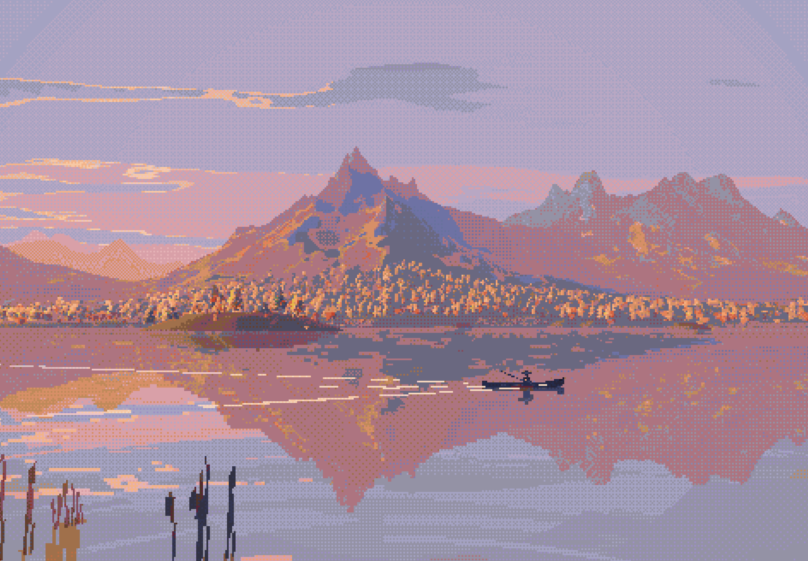
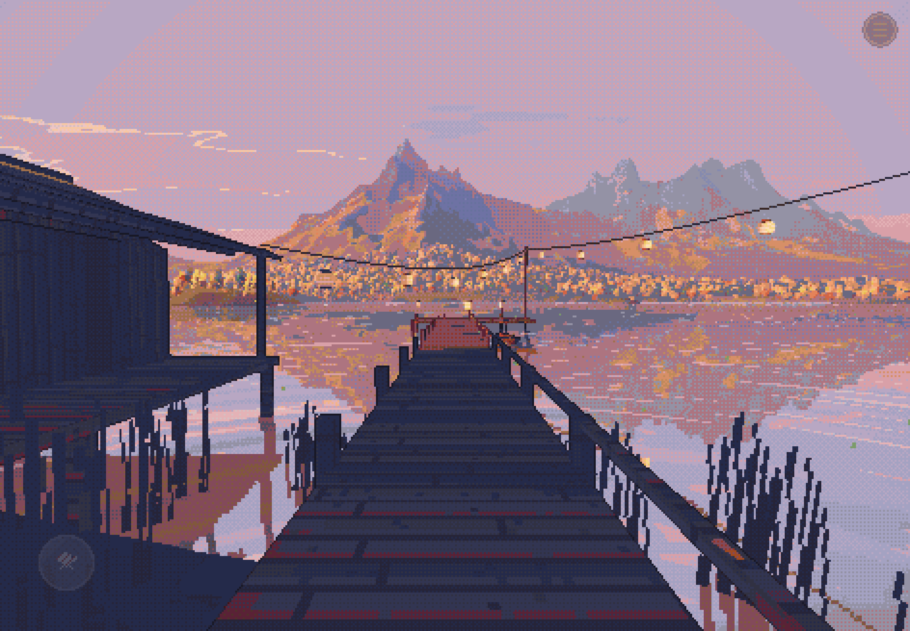

# HOTARU

A quiet, fully 3D, first-person Japanese-inspired exploration game rendered as a
living pixel-art painting. Runs offline on iPad as a PWA.

- Design & tech spec: [`SPEC.md`](SPEC.md)
- Plan, tech choices & risks: [`PLAN.md`](PLAN.md)
- Decision log: [`DECISIONS.md`](DECISIONS.md)
- Reference look: [`reference/`](reference/)

## Status

| # | Milestone | Status | Screenshots | iPad benchmark (Medium) |
|---|---|---|---|---|
| M1 | Foundations & THE LOOK prototype | 👀 Waiting for review | [M1](docs/screenshots/M1/) | pending (run on iPad) |
| M2 | Terrain & world streaming | ⬜ Not started | — | — |
| M3 | Player controller & controls | ⬜ Not started | — | — |
| M4 | Water | ⬜ Not started | — | — |
| M5 | Vegetation, wind & particles | ⬜ Not started | — | — |
| M6 | Regions, weather & seasons | ⬜ Not started | — | — |
| M7 | Buildings, villages & interiors | ⬜ Not started | — | — |
| M8 | Fauna | ⬜ Not started | — | — |
| M9 | Villagers & wanderers | ⬜ Not started | — | — |
| M10 | Castle, shrines, caves & secrets | ⬜ Not started | — | — |
| M11 | Items, journal, map, photo, boats, fishing | ⬜ Not started | — | — |
| M12 | Lore, spirits & festivals | ⬜ Not started | — | — |
| M13 | Audio | ⬜ Not started | — | — |
| M14 | Polish, performance & release | ⬜ Not started | — | — |

Legend: ⬜ not started · 🔨 in progress · 👀 waiting for review · ✅ done

### M1 at a glance

| Night dock (reference 1) | Mirror lake at dusk (reference 2) |
|---|---|
|  |  |
| **Title screen** | **On the pier (touch HUD)** |
|  |  |

M1 checks:

| Check | Result |
|---|---|
| Type-check + build | ✅ |
| Unit tests (`npm test`) | ✅ 29 passed |
| Offline boot + save load (`npm run e2e:offline`) | ✅ |
| Pixel stability (`npm run e2e:stability`) | ✅ sub-pixel turn: 0 changed pixels |
| Console errors in screenshot runs | ✅ none |
| Download size (precache) | 813 KB |
| Headless perf (software GL, regression only) | see below |
| iPad Air benchmark | ⏳ needs a run on the iPad |

Headless software-rendered numbers (SwiftShader, 2360×1640, *not* representative of a GPU):

| Preset | Internal res (1180×820 viewport) | Avg frame | 1 % low | Draw calls | Triangles (all passes) |
|---|---|---|---|---|---|
| Low | 394×274 ×3 | 789 ms | 883 ms | 101 | 855 k |
| Medium | 590×410 ×2 | 926 ms | 1017 ms | 101 | 855 k |
| High | 590×410 ×2 | 1086 ms | 1300 ms | 101 | 855 k |

Triangles and draw calls are the meaningful numbers here (budget: < 400 draws, < 1.5 M
triangles); frame times need the iPad run.

## Install on iPad (works offline)

1. One-time setup (repo owner): make the repository public, then
   *Settings → Pages → Source: GitHub Actions*. Every push to `main` deploys.
2. On the iPad, open **https://thetaminolutz.github.io/hotaru/** in Safari once.
3. Tap **Share → Add to Home Screen**.
4. Start Hotaru from the home screen. Everything is cached; airplane mode works.
   When a new version has been downloaded, a small paper toast offers a restart.

## Controls (M1)

| | Desktop | iPad |
|---|---|---|
| Look | click, then mouse | drag on the right side |
| Walk | WASD (Shift jogs) | left thumb (koi stick; push far to jog) |
| Menu | Esc | lacquer token, top right |
| Debug panel | `` ` `` | three-finger tap |

The full movement set (jump, wade, swim, sit, lie, rowing) arrives in M3.

## Benchmark on the iPad

Open the debug panel (three-finger tap) → **Benchmark (current preset)** (60 s) or
**All presets** (3 min). Copy the result line and paste it back; it goes into the table above.

## Development

```sh
npm ci
npm run dev            # http://localhost:5173  (?debug=1 opens the debug panel)
npm test               # unit tests (Vitest)
npm run build          # production build + service worker in dist/
npm run shots          # milestone screenshots → docs/screenshots/M1/
npm run e2e:offline    # offline boot test (builds must exist)
npm run e2e:stability  # pixel stability test
npm run icons          # regenerate app icons & launch images
```

Useful URL parameters: `?shot=dock-night|lake-dusk|dock-golden|dock-day|lake-night|pier-end`,
`?t=17.5` (hour), `?ui=gallery` (every UI element), `?quality=low|medium|high`,
`?off=bloom,quantize,outlines,reflections,shadows,grade,vignette`, `?seed=123`, `?play=1`.
