# HOTARU

A quiet, fully 3D, first-person Japanese-inspired exploration game rendered as a
living pixel-art painting. Runs offline on iPad as a PWA.

- Design & tech spec: [`SPEC.md`](SPEC.md)
- Plan, tech choices & risks: [`PLAN.md`](PLAN.md)
- Decision log: [`DECISIONS.md`](DECISIONS.md)
- Reference look: [`reference/`](reference/)

## A quick tour

Walk out onto the lantern pier at dusk, row across a mirror lake, talk with villagers who
remember you, find 112 secrets, fish, take photos and ink sketches, and, if you piece the old
castle's story together, float the thousandth lantern on festival night. There is no
combat, no health and no way to fail. Everything is pixel art, generated in code, and it
runs offline on an iPad.

| | | |
|---|---|---|
| 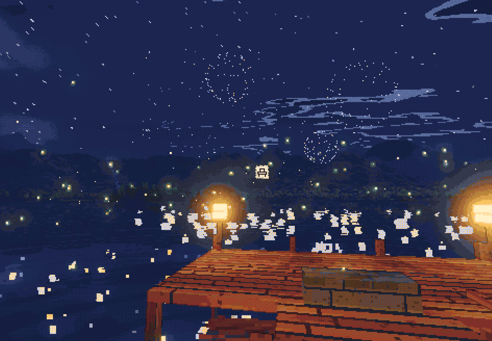 | 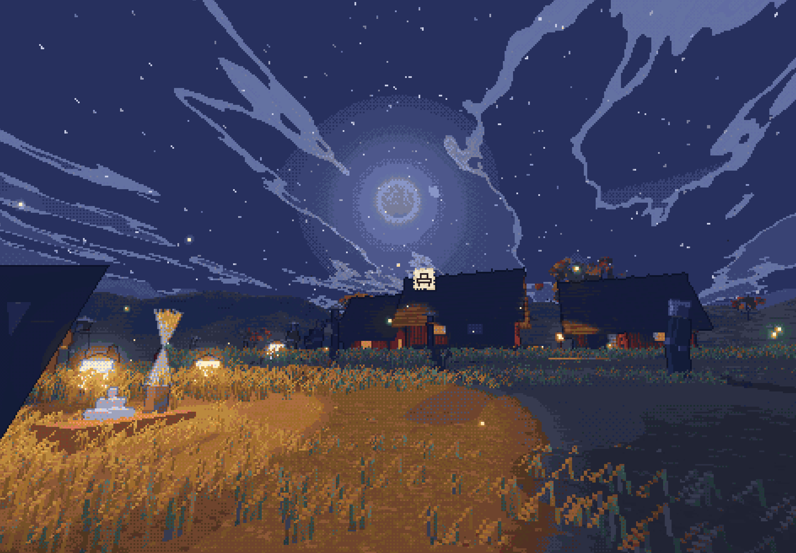 | 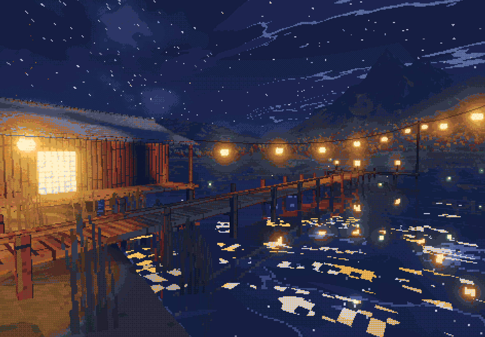 |
| 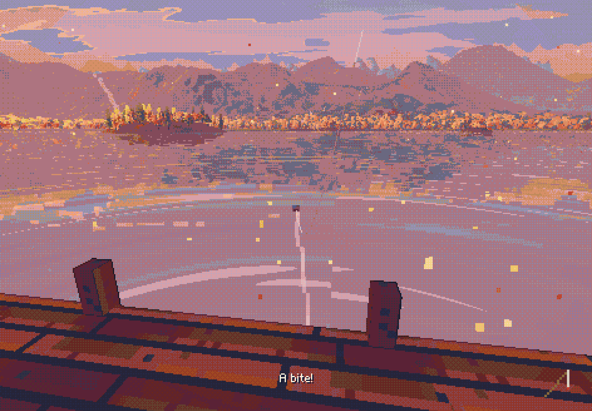 | 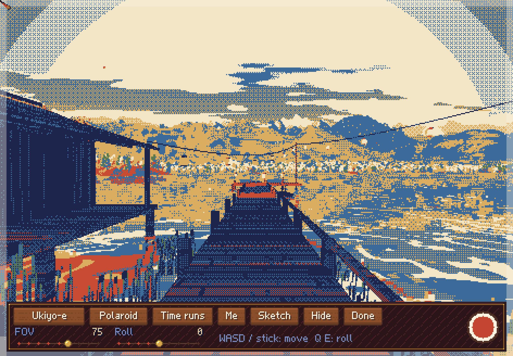 | 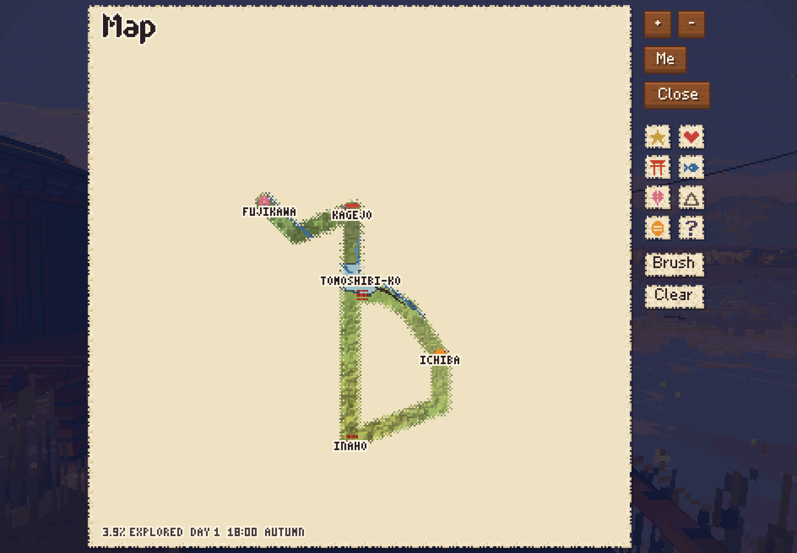 |
| 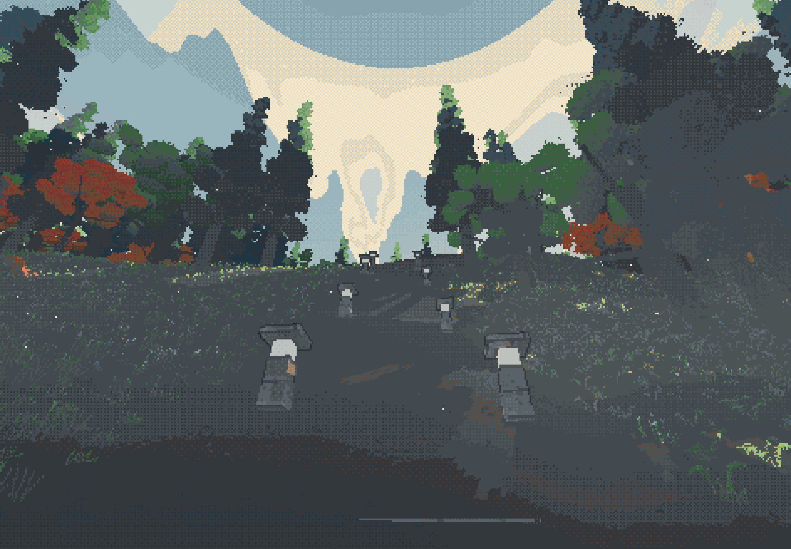 | 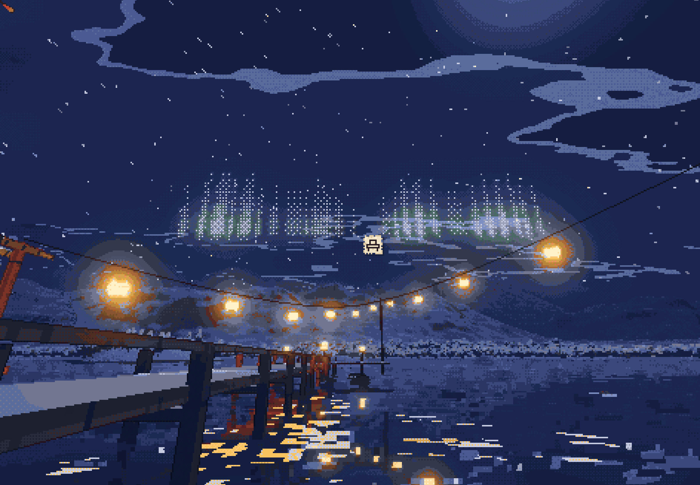 | 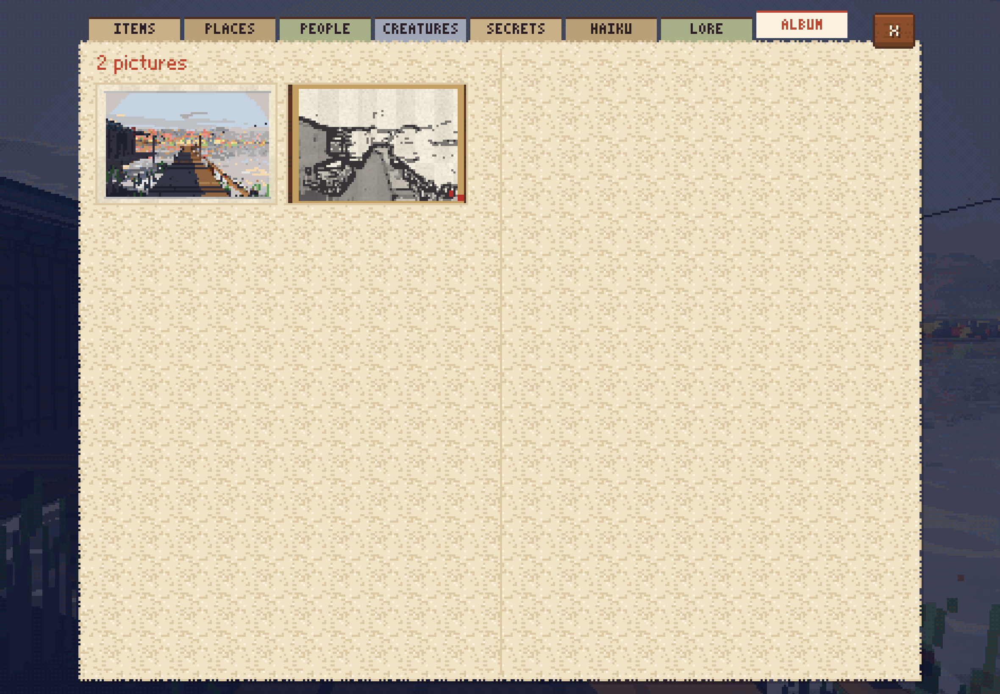 |

## Status

| # | Milestone | Status | Screenshots | iPad benchmark (Medium) |
|---|---|---|---|---|
| M1 | Foundations & THE LOOK prototype | ✅ Done | [M1](docs/screenshots/M1/) | pending (run on iPad) |
| M2 | Terrain & world streaming | ✅ Done | [M2](docs/screenshots/M2/) | pending (run on iPad) |
| M3 | Player controller & controls | ✅ Done | [M3](docs/screenshots/M3/) | pending (run on iPad) |
| M4 | Water | ✅ Done | [M4](docs/screenshots/M4/) | pending (run on iPad) |
| M5 | Vegetation, wind & particles | ✅ Done | [M5](docs/screenshots/M5/) | pending (run on iPad) |
| M6 | Regions, weather & seasons | ✅ Done | [M6](docs/screenshots/M6/) | pending (run on iPad) |
| M7 | Buildings, villages & interiors | ✅ Done | [M7](docs/screenshots/M7/) | pending (run on iPad) |
| M8 | Fauna | ✅ Done | [M8](docs/screenshots/M8/) | pending (run on iPad) |
| M9 | Villagers & wanderers | ✅ Done | [M9](docs/screenshots/M9/) | pending (run on iPad) |
| M10 | Castle, shrines, caves & secrets | ✅ Done | [M10](docs/screenshots/M10/) | pending (run on iPad) |
| M11 | Items, journal, map, photo, boats, fishing | ✅ Done | [M11](docs/screenshots/M11/) | pending (run on iPad) |
| M12 | Lore, spirits & festivals | ✅ Done | [M12](docs/screenshots/M12/) | pending (run on iPad) |
| M13 | Audio | ✅ Done | [M13](docs/screenshots/M13/) · [listen](docs/audio/) | pending (run on iPad) |
| M14 | Polish, performance & release | ✅ Done | [M14](docs/screenshots/M14/) | pending (run on iPad) |

Build order (owner's revision): M2 → M3 → M5 → M13 → M7 → M8 → M4 → M6 → M9 → M10 → M11 → M12 → M14.

Legend: ⬜ not started · 🔨 in progress · 👀 waiting for review · ✅ done

### Feedback round 3 at a glance (a wanderer in old Japan)

- **Ruins with secrets:**
  - Takamine Fort, Kitayama Castle and the sea fort Umi-toride: broken walls and keep bases
    you can climb.
  - A moor watchtower you can climb, Kirinoya (an empty hamlet whose lanterns light
    themselves at night), a forgotten shrine and an old temple gate.
  - 11 relics to find with "Look closer". They have their own journal category, "Ruins &
    relics".
- **On the road:** jizo, milestones, wayside shrines, three teahouses to rest at, and an open
  sekisho checkpoint.
- **Village streams:** Ichiba, Inaho, Yukemuri and Sakuraoka have streams running through
  them, with bridges on the streets.
- **Villagers** (clothed):
  - Faces that blink and smile, four hairstyles, work clothes and headbands, straw rain
    capes.
  - Children swim in summer, evening soaks at the Yukemuri onsen, naps in the grass.
- **Also:** fish schools in the lake, rivers and ponds; trees with branches into every leaf
  cluster; no more wall clipping.

| | | |
|---|---|---|
| 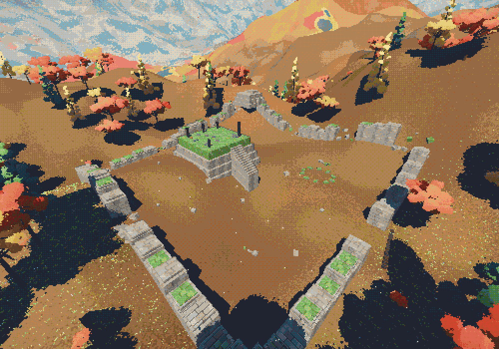 | 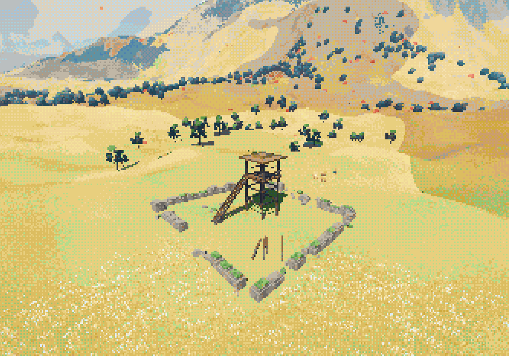 | 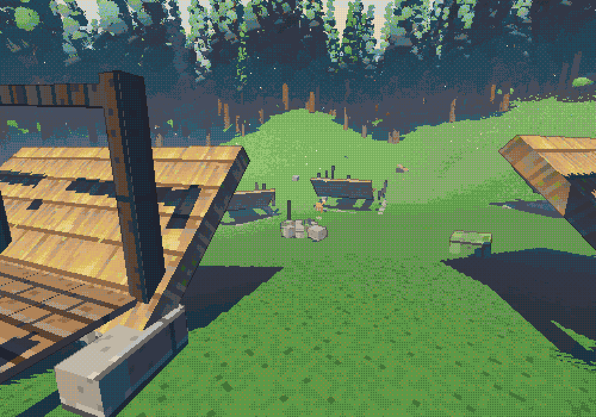 |
| 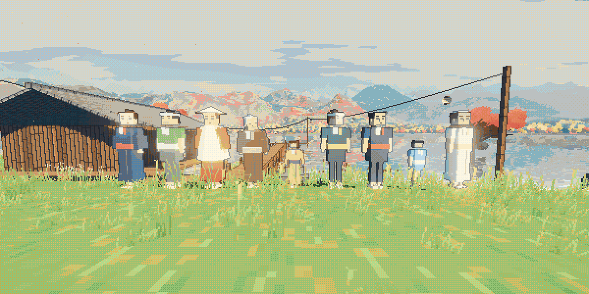 | 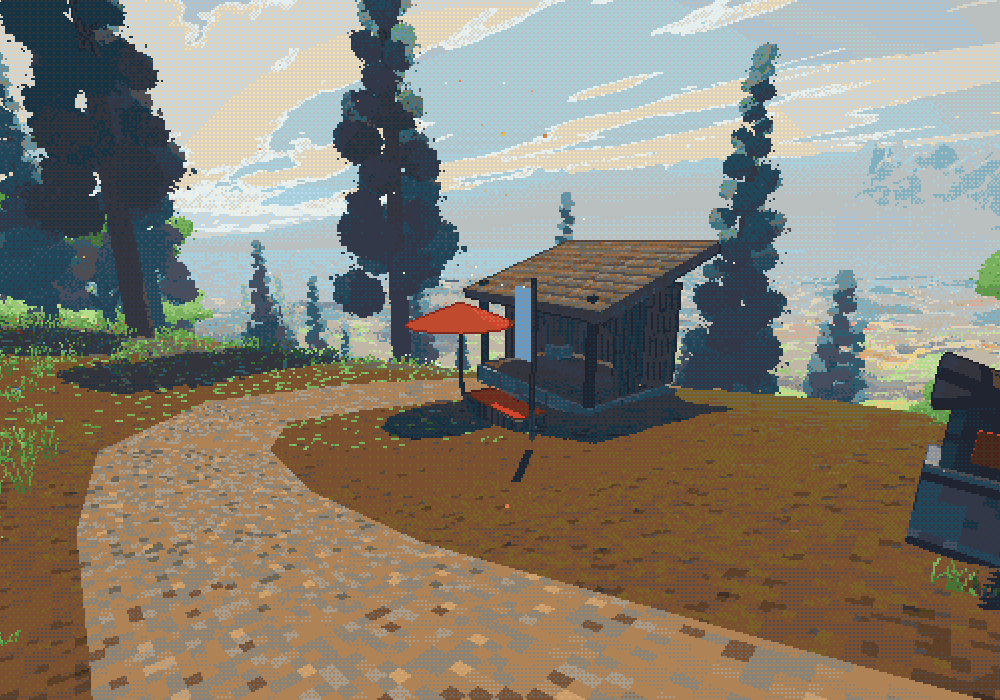 | 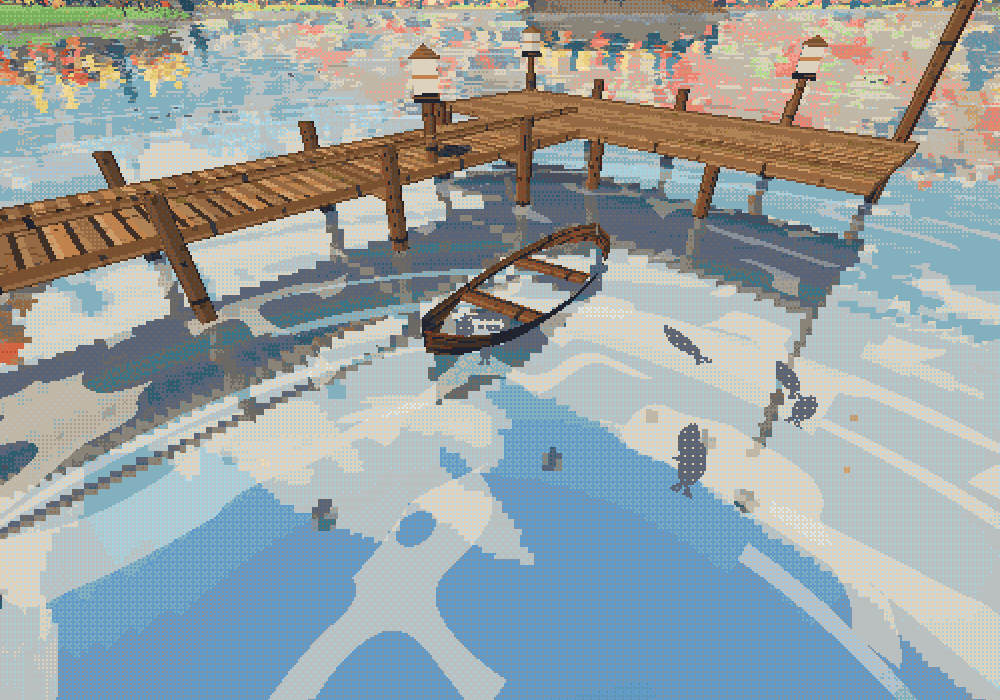 |

### M14 at a glance (polish & release)

- **Performance:**
  - The water reflection now skips terrain under the water line (the lake bed), forest
    tiles beyond 420 m, and tree trunks.
  - The Medium preset at the busiest spot (the dock) is under 400 draw calls. The visible
    pass is at most about 615 k triangles, against a budget of 1.5 M.
  - `scripts/perf-breakdown.mjs` lists triangles and draws per pass and per group.
  - Headless bench, all passes summed along the benchmark route:
    - Low: 310 draws, 1.30 M triangles
    - Medium: 359 draws, 1.68 M triangles
    - High: 405 draws, 1.92 M triangles
  - Real frame times still need the iPad benchmark (debug panel).
- **Auto quality and a frame cap.**
- **Comfort & accessibility:** reduced motion, large text, high contrast, subtitles, mono
  sound, a left-handed touch layout.
- **Saves:** three slots, a backup of the previous save with automatic fallback, export
  and import as a file. New Journey confirms before replacing, and starts from a clean world.
- **Gentle diegetic hints:** Akari, Old Genzō and others mention things once, when they
  become useful (talking, the journal and map, the lantern at dusk, sitting and
  time-lapse, the rod at the water, the boat, full pockets, photos, the tablets, gifts).
  - Hints follow your input device.
  - They can be turned off.
- Long toasts wrap onto several lines.
- More loading-screen haiku.

### M12 at a glance (the story, spirits, festivals)

- **Five festivals from the calendar:** one on the fourth day of each season, plus New Year.
  Villagers announce each one in the days before, and guests from every village gather.
  - **Hanami:** blankets and lantern poles under the Sakuraoka blossoms.
  - **Lantern & Firefly Festival** on the Tomoshibi shore:
    - food stalls, a yagura with a taiko and a ring of lanterns
    - about 90 floating lanterns drifting out on the lake
    - fireworks reflected in the water, their boom arriving after the flash
  - **Tsukimi:** a big harvest moon, dumplings and pampas grass on the hill above Inaho.
  - **Snow Lantern Night:** candle-lit snow lanterns along every street of Yukemuri.
  - **New Year:** the Kumoji bell rings 108 times.
- **Spirits, gentle and never scary:**
  - lantern spirits drifting toward the island shrine every third night
  - kodama that click their heads around you when you stand still in the cedar, bamboo or
    maple woods, and vanish when you move
  - a white fox that leads you to a shrine you haven't found
  - the great forest guardian in the cedar mist at dawn
  - soft blue "echoes" of happy moments in the castle at dusk
  - spirit lights (aurora curtains) on clear winter nights
  - the old umbrella by your chest that hops when you're not looking
- **Rare world events** (about two days in five):
  - cranes flying south, a meteor shower, a red-moon eclipse
  - a lantern crossing the lake alone, a whale in the bay, a sea of clouds below the temple
  - a deer and her fawn, monkeys stealing persimmons
- **The ending moment:** once you've read 15 stone tablets, the masked stranger gives you
  the thousandth lantern. On the night of the Lantern Festival you float it from the pier:
  - the fireflies gather into a path across the lake to the castle
  - the sister's spirit walks it home
  - the stranger takes off the mask (Haruto, the last lantern keeper)
  - the castle garden blooms
  - Afterwards the world is brighter: more fireflies, more lanterns, lantern spirits every
    night, and people talk about it.
- **The castle garden blooms step by step** as the story is pieced together.
- **Dreams** when you sleep at home at night: 20 short dream-haiku, some carrying the story.
- **Flute melodies:** the waterfall, the secret garden and the island shrine answer them.
- **112 secrets:** 23 shrines, 24 viewpoints, 30 tablets, 5 hidden places, 19 rare moments
  (festivals, world events, melodies) and 11 spirit encounters.
- **Dialogue: 1500+ unique lines.** People now:
  - remember where you've been ("your sandals have that red dust")
  - pass on rumours that hint at secrets, and news of what you found
  - talk about the coming festival, and about the world after the ending
  - react to gifts by personality, and say goodbye
  - The new lines also cover proverbs, food, spirits, Japanese words explained, late-night
    talk, children's games and ten more lines per wanderer.
- **Headless perf** (relative only): Low 313 draws · 1.32 M triangles, Medium 363 · 1.68 M,
  High 411 · 1.99 M. That is +4 draws for the spirits (pooled, hidden when not in use).

### M11 at a glance (items, journal, map, photos, boats, fishing)

- **Pockets:** 12 keepsake slots plus tools that never take a slot.
  - About 200 keepsakes lie around the world, 21 kinds in all: shells on the sand, smooth
    stones on river banks, feathers in forests, flowers in meadows, and village finds.
  - A few are hand-placed: the fox mask, the storehouse key, the star chart, the lost doll.
  - Common finds grow back after a few days.
- **Gifts:** every keepsake is liked by some kinds of people. A liked gift deepens the
  friendship and sometimes earns a keepsake in return. Offering-type keepsakes count double
  at shrines.
- **Tools from people:** Akari gives you the lantern, Old Genzō the rod and then the boat,
  the hermit the flute, the peddler the umbrella. The map, camera and sketchbook are yours
  from the start.
- **Lantern:** lights your way at night as a real light.
- **The journal (J):** a washi notebook with tabs for Items (and your home chest), Places,
  People (portraits and likes), Creatures (animals seen, fish with their best sizes),
  Secrets (counts only), Haiku, Lore and the Album.
- **The map (M):** painted in ink and watercolour from the real terrain.
  - It reveals only where you've been, with soft dithered edges.
  - Place names appear as you discover them.
  - 8 stamps, zoom and pan.
  - Draw on it with Apple Pencil; the line width follows pressure.
- **Photo mode (P):**
  - A free camera within 15 m, with FOV and roll.
  - Palette filters (sepia, ukiyo-e print, ink, night blue) and frames (washi, polaroid,
    scroll).
  - Stop time, or take a self-portrait of the traveller in a straw hat.
  - Photos go into the album. Save them to the iPad, or draw on them with the Pencil.
- **Sketchbook:** the view turned into an ink-wash drawing on paper, with a red seal.
- **Fishing:** cast at open water (F with the rod), watch the float, press on the bite and
  hold to reel in.
  - A missed bite comes back. There is no fail state.
  - 30 species, by water, hour, season and rain; each catch is noted with its size and
    then released.
- **Boats:**
  - Row the boat from the Tomoshibi pier: forward/back to row, left/right to steer.
  - Step ashore at any pier or gentle bank.
  - A ferry runs between Shiomachi and the lake every two hours.
- **Your house:** the boathouse, with a storage chest on its engawa and a small garden
  where seeds grow over days.
- **Headless perf** (software GL, so only relative): Low 309 draws · 1.32 M triangles,
  Medium 359 · 1.68 M, High 407 · 1.99 M. That is +2 or 3 draws over M10, for the pickups,
  the garden and the float.

### M10 at a glance (castle, temple, caves & secrets)

**Kagejō**, the ruined castle above the lake:
- crumbling stone walls, a gatehouse and an overgrown courtyard
- an inner garden with a pond
- a **five-storey keep you can climb** to a balcony over the lake
- a **secret garden** behind a hidden gate

**Kumoji** has a stone stairway lined with lanterns, up to a temple hall, a five-storey pagoda and a bell you can ring.

**Three caves:** behind the Great Waterfall, in the ice of the high pass, and under the sea cliffs.

**85 secrets to find:**
- **23 hidden shrines.** Make an offering once a day and the shrine slowly restores (a rope, then a candle, then flowers), each with its own haiku.
- **24 viewpoints.** Sit down and the view pans slowly while a haiku appears in brush lettering.
- **30 stone tablets** that piece together the castle's story.
- **5 hidden places.**
- **3 rare moments:** a fox wedding in a sunshower, a bell that rings itself in the snow, and writing that only shows by moonlight.

| Kagejō's keep | The lake from the keep's balcony |
|---|---|
| 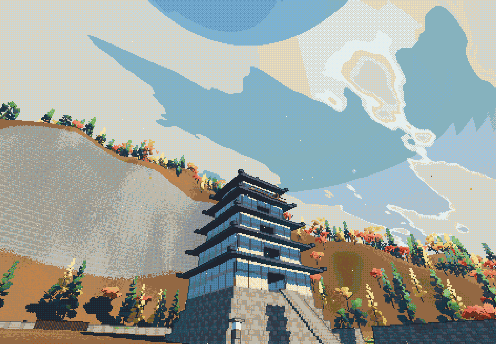 | 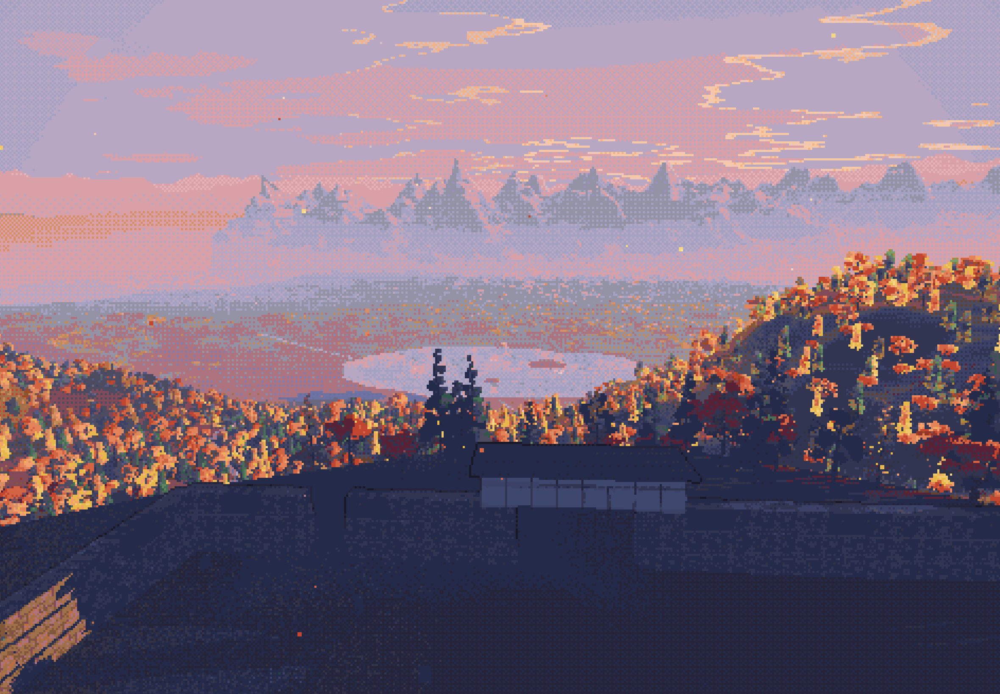 |
| **The cave behind the waterfall** | **A viewpoint haiku at the pier** |
| 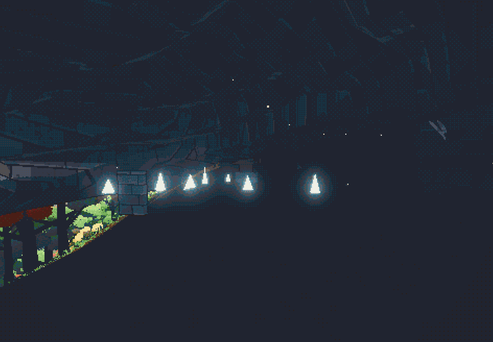 | 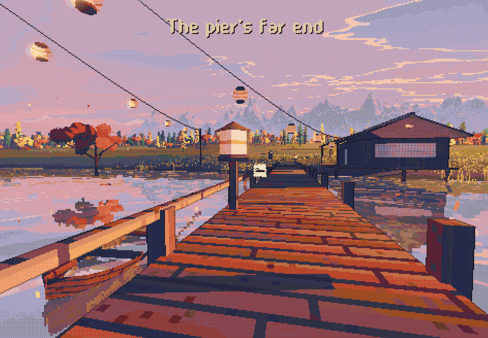 |

| Check | Result |
|---|---|
| Unit tests | ✅ 63 passed (lore and haiku, castle plateau, walkable grotto ramps) |
| All e2e | ✅ offline, stability, controls, audio, houses, fauna, water, people, secrets |
| Draw calls · triangles | Low 307 · 1.30 M — Medium 356 · 1.66 M — High 404 · 1.97 M (High just over the 400 budget; M14 trims) |
| Secrets e2e (`npm run e2e:secrets`) | ✅ 85 secrets; shrine restores 1→3 over days (once per day); viewpoint pan with haiku; tablet; cave found on entering; hidden gate; 5 keep storeys (standing on the ground floor stays there) |

### M9 at a glance (villagers)

The villages are inhabited: **117 villagers** and **16 wanderers**. Among the wanderers are a travelling poet, a pilgrim with a bell, a peddler, a painter, Akari the lantern maker, a masked stranger at dusk, a star watcher and the postman.

**Daily routines by trade:**
- Farmers work the terraces.
- Fishers go out before dawn.
- Potters, weavers and carpenters work in their workshops.
- Shopkeepers and tea masters sweep their step and then open.
- Monks pray at dawn and dusk.
- Children play by the well and the river.
- Elders sit on the plaza.
- In the evening everyone gathers to chat.

**At dusk the lantern maker walks the village and lights every lantern, one by one,** and puts them out again at dawn.

**How they react:**
- Umbrellas come out in the rain, and everyone goes home in a storm.
- They turn to you: a bow the first time, a wave later, and eventually a nickname.

**Talking:** 518 different gentle lines depend on who they are, how well they know you, the time, the weather, the season and the village, plus gossip about the neighbours. Each speaker has a pixel portrait and soft voice babble.

| Evening on the plaza | Umbrellas in the rain |
|---|---|
| 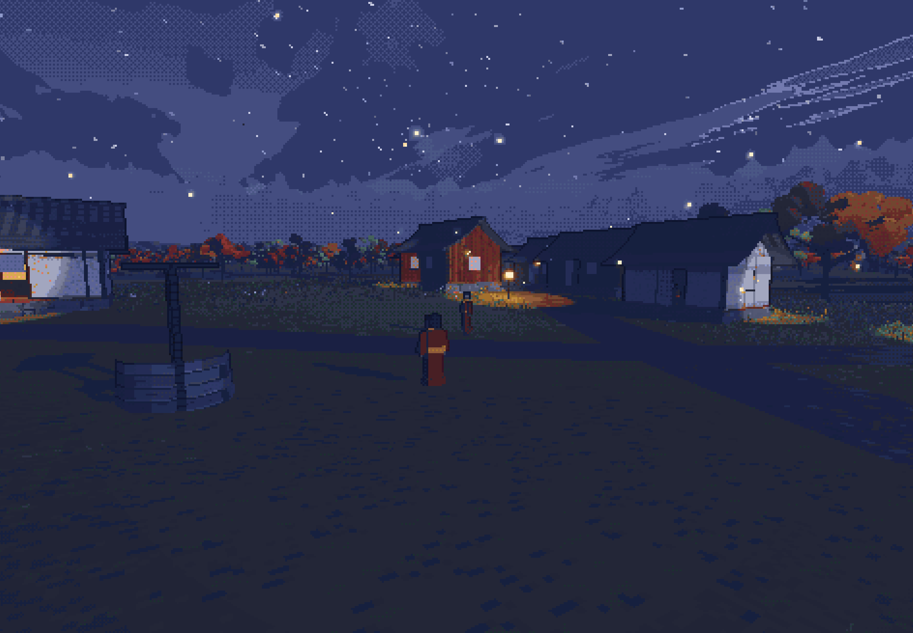 | 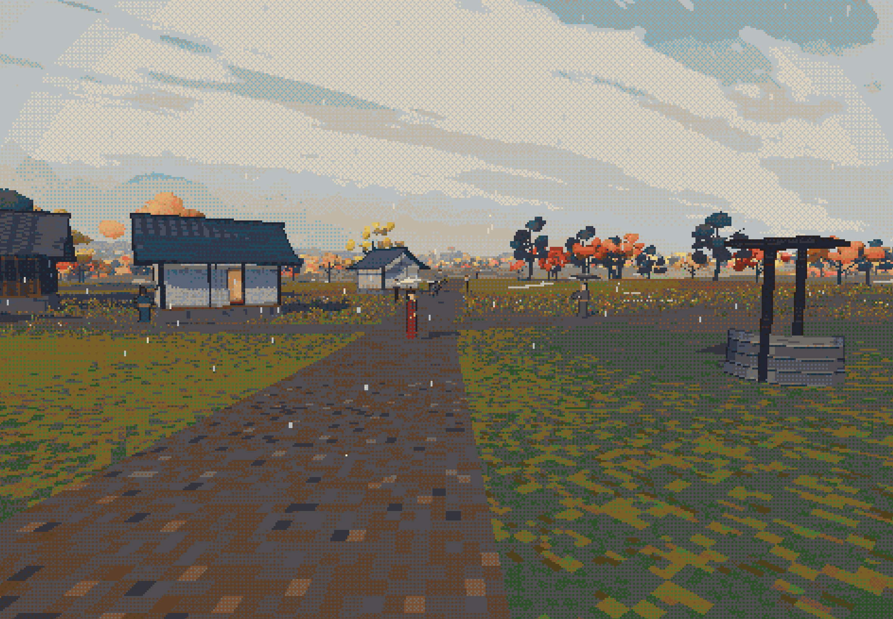 |
| **Children at the well** | **Talking to Akari** |
| 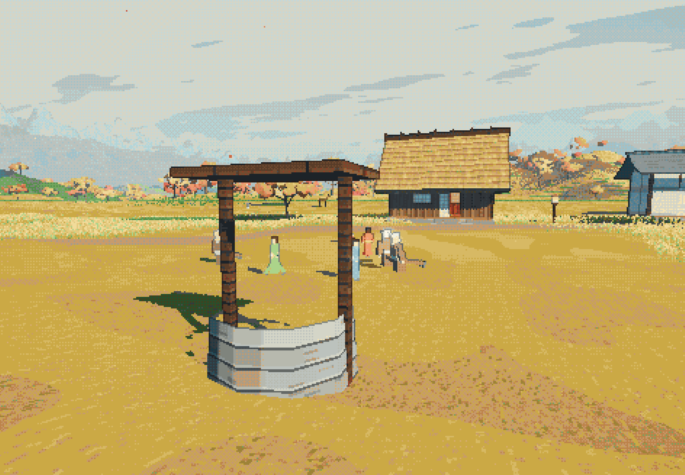 |  |

| Check | Result |
|---|---|
| Unit tests | ✅ 61 passed (518 distinct lines, schedules, first meeting vs. nickname, weather-aware talk) |
| People e2e (`npm run e2e:people`) | ✅ 133 people; they move through the day, the lantern maker lights lanterns, umbrellas in rain, talking works and is remembered |
| All e2e | ✅ offline, stability, controls, audio, houses, fauna, water, people |
| Draw calls · triangles (Medium) | 334 · 1.65 M (everyone is one draw) |

### M6 at a glance (weather & seasons)

**Four seasons.** A new journey starts in autumn. Each season lasts 3, 7 or 14 days, or you can lock one (*eternal autumn*) in **Settings → World**.
- **Spring:** cherries and plums blossom, the grass is fresh green, and the rice terraces are flooded.
- **Summer:** deep green, green rice, and the most fireflies.
- **Autumn:** red maples and golden rice.
- **Winter:** bare trees, red camellias, and snow on ground, roofs and treetops.

**Changing weather:** clear, cloudy, overcast, drizzle, rain, heavy rain, thunderstorms, fog, sunshowers and snow.
- Weather changes slowly, and each season and region has its own climate.
- In rain everything darkens and puddles mirror the sky. Rain rings spread on the lake.
- Lightning comes first and the thunder follows by distance.
- A rainbow appears after rain.

| Cherry hills in spring | Inaho under snow |
|---|---|
| 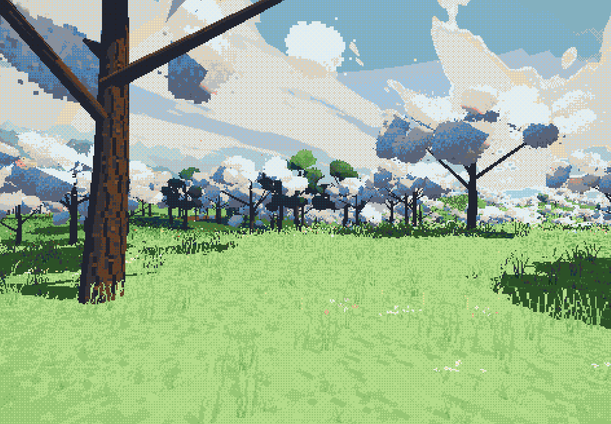 | 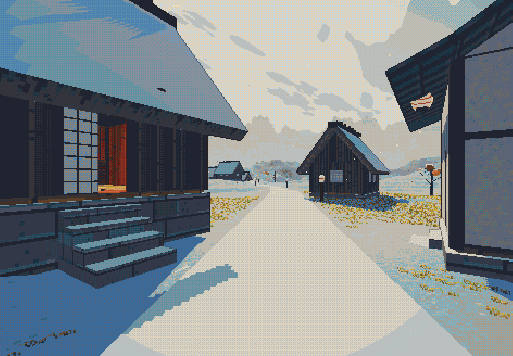 |
| **Storm over the lake** | **Sunshower with a rainbow** |
| 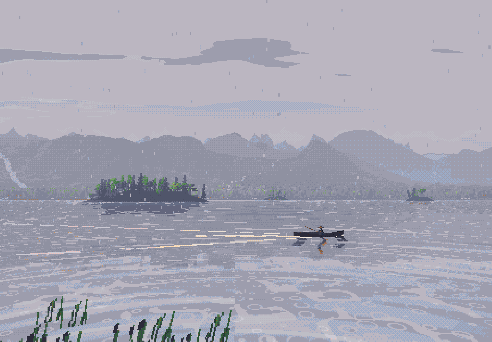 |  |
| **Rice valley in summer** | **Fog in the cedar forest** |
| 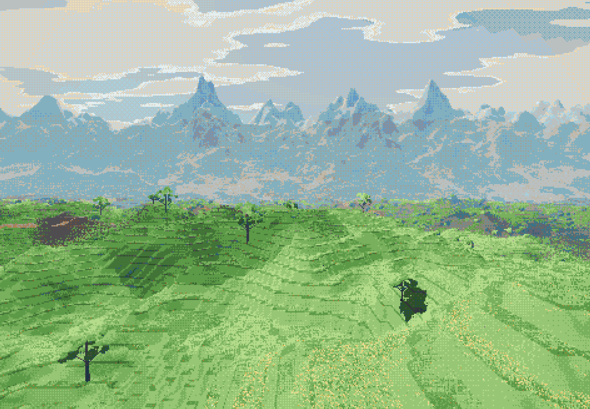 | 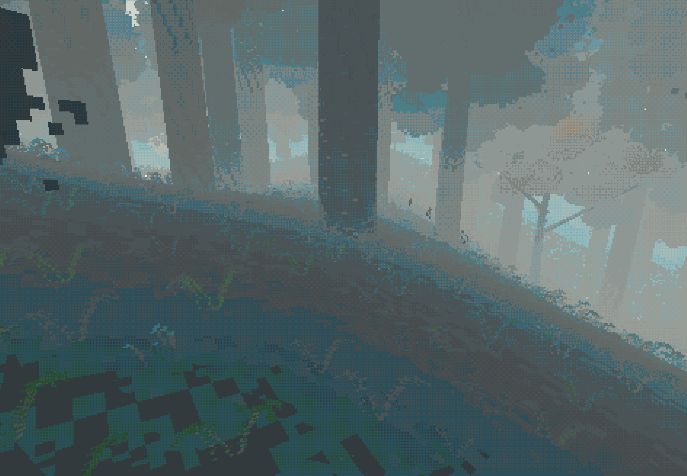 |

| Check | Result |
|---|---|
| Unit tests | ✅ 57 passed (season blending, tree looks, weather cycling, rain → snow in winter, thunder after lightning) |
| All e2e | ✅ offline, stability, controls, audio, houses, fauna, water |
| Draw calls · triangles (Medium) | 331 · 1.65 M |

### M4 at a glance (water)

**Rivers:**
- A main river runs from the snowy pass, over the **Great Waterfall**, into Lantern Lake, and out through the marsh to the sea.
- Tributaries flow down from mountain springs, and some end in quiet ponds.
- Riverbeds are carved into the land, and water always flows downhill.
- You can wade and swim in rivers and ponds, and roads cross them on plank bridges.

**The waterfall:** a falling sheet of water with mist at its foot, and a rainbow when the sun is behind you.

**Lake and sea:**
- Ripples spread when you wade or swim, when ducks paddle, and when fish jump (with a splash, more often at dusk).
- Sunlight makes a moving net of caustics over sunny shallows.
- The open sea has swells, and surf breaks white on the coast.

| The Great Waterfall | River at dusk |
|---|---|
| 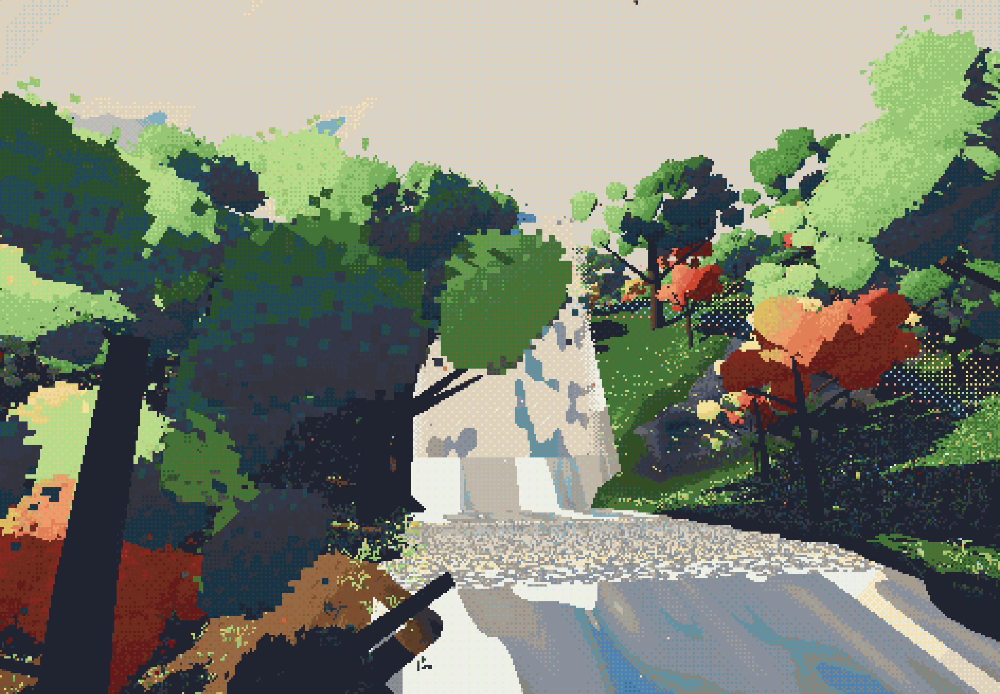 | 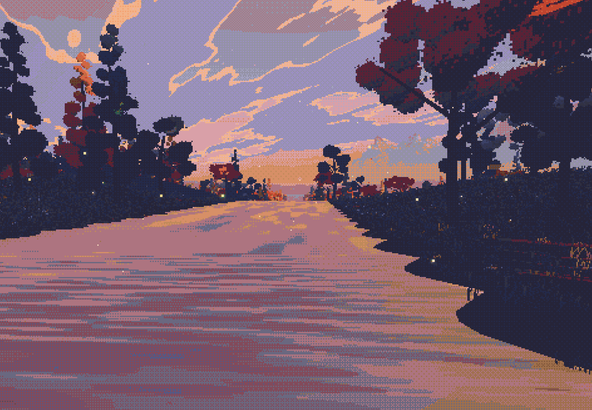 |
| **Mountain river** | **Surf on the eastern coast** |
| 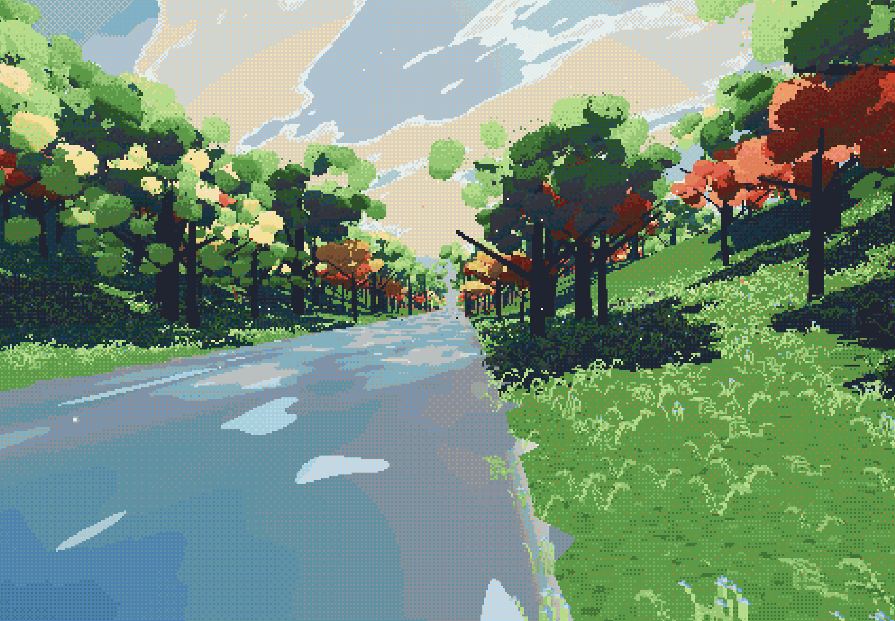 |  |

| Check | Result |
|---|---|
| Unit tests | ✅ 51 passed (hydrology deterministic, water only flows downhill, beds carved under the surface) |
| Water e2e (`npm run e2e:water`) | ✅ swim in the upper river at its own level (21.6 m), ripples in the lake |
| All e2e | ✅ offline, stability, controls, audio, houses, fauna, water |
| Draw calls · triangles (Medium) | 331 · 1.65 M (rivers, ponds and falls are one draw) |

### M8 at a glance (animals)

**41 species**, all peaceful, all animated in code:

- **Wild animals:** sika deer, tanuki, foxes (and a rare white fox at night), macaques, serow, hares, boar with striped piglets, squirrels, tortoises, tree frogs
- **Village and farm animals:** cats (tabby, calico, black), shiba and akita dogs, horses, cows, chickens, a temple goat
- **Birds:** cranes, herons, egrets, ducks, mandarin ducks, gulls, kites, crows, sparrows, swallows, pigeons, pheasants, ptarmigans, owls
- **Water life and insects:** koi, crabs, red dragonflies, swallowtails, small whites, bees

How they behave:
- They live where they should, and at their own hours. Deer lie down in the grass at night, and tanuki come out at dusk.
- Jogging scares them and birds take off. Stand still and the curious ones come over.
- You can pet cats, dogs and horses, which slowly builds their trust.
- Bow to the temple deer and they bow back.

| Deer at the temple | Cats and sparrows in Ichiba |
|---|---|
| 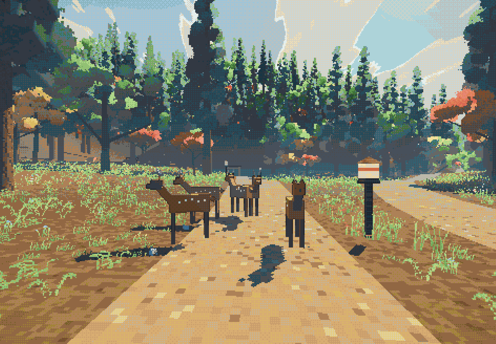 | 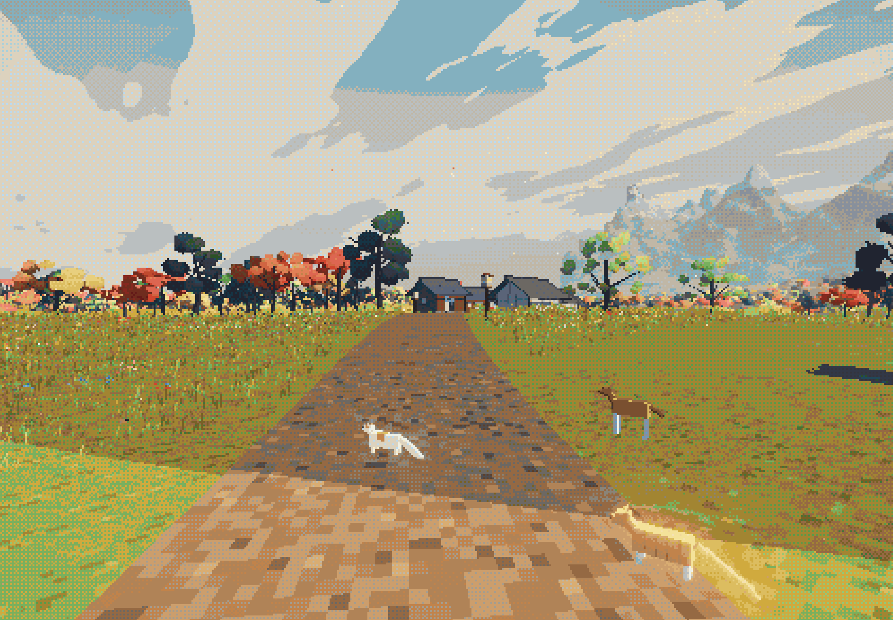 |
| **Macaques at Yukemuri** | **Tanuki at night** |
| 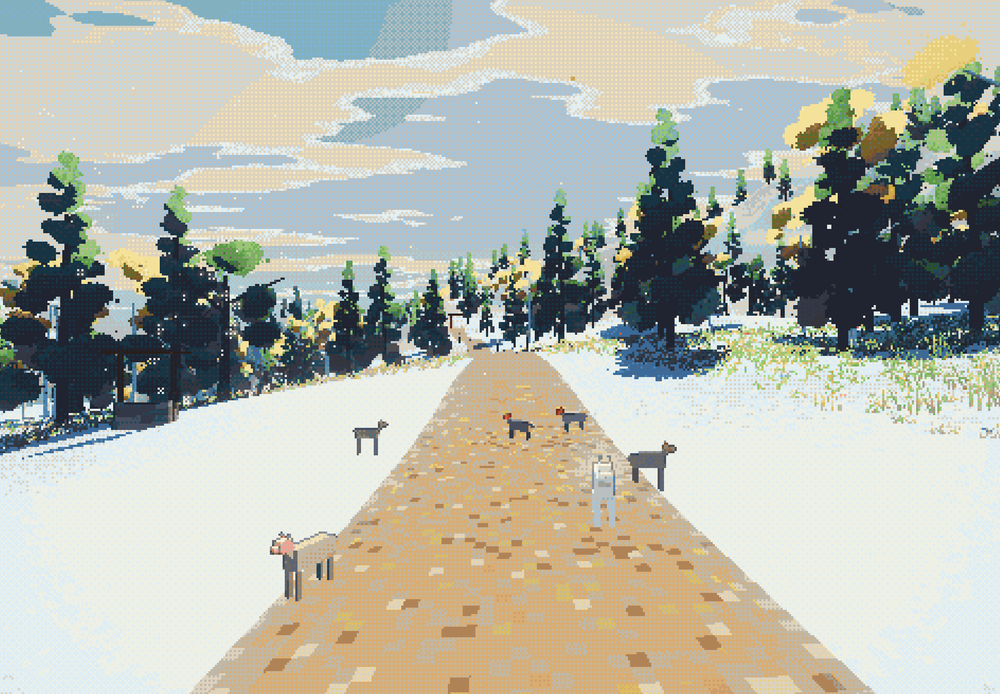 |  |

| Check | Result |
|---|---|
| Unit tests | ✅ 47 passed (41 species, every body builds with animatable parts) |
| Fauna e2e (`npm run e2e:fauna`) | ✅ animals in 100 % of 10 places × day/night, flee from a jogger, petting builds trust, deer bow back |
| Other e2e | ✅ offline, stability, controls, audio, houses |
| Draw calls · triangles (headless benchmark, all passes) | Low 281 · 1.29 M — Medium 329 · 1.65 M — High 374 · 1.95 M |

Medium is now slightly over the 1.5 M triangle budget (forests + animals); M14 trims LODs
against the real iPad benchmark.

### M7 at a glance (villages & houses)

**Seven villages**, joined by winding dirt roads:

- **Ichiba:** a market town with tiled machiya, shops and workshops
- **Inaho:** thatched farmhouses among the rice terraces
- **Chabatake:** a tea hamlet
- **Shiomachi:** a fishing harbour
- **Sakuraoka:** on the cherry hills
- **Yukemuri:** a hot-spring village with an onsen
- **Kumoji:** a shrine settlement

**Every house can be entered.** Walk up the stone steps and the shōji door slides open, with no loading screen. Inside are:

- tatami, an irori hearth with a kettle, and cushions you can sit on
- a tokonoma alcove with a scroll and flowers, and andon lamps
- tools for the owner's trade: a potter's wheel, a lantern maker's lanterns, a loom, nets
- futons laid out at night

Interiors are lamp-lit and darker than outside. Windows glow at night, so villages shine from the hills.

| Inside a farmhouse | Farmhouse at night |
|---|---|
| 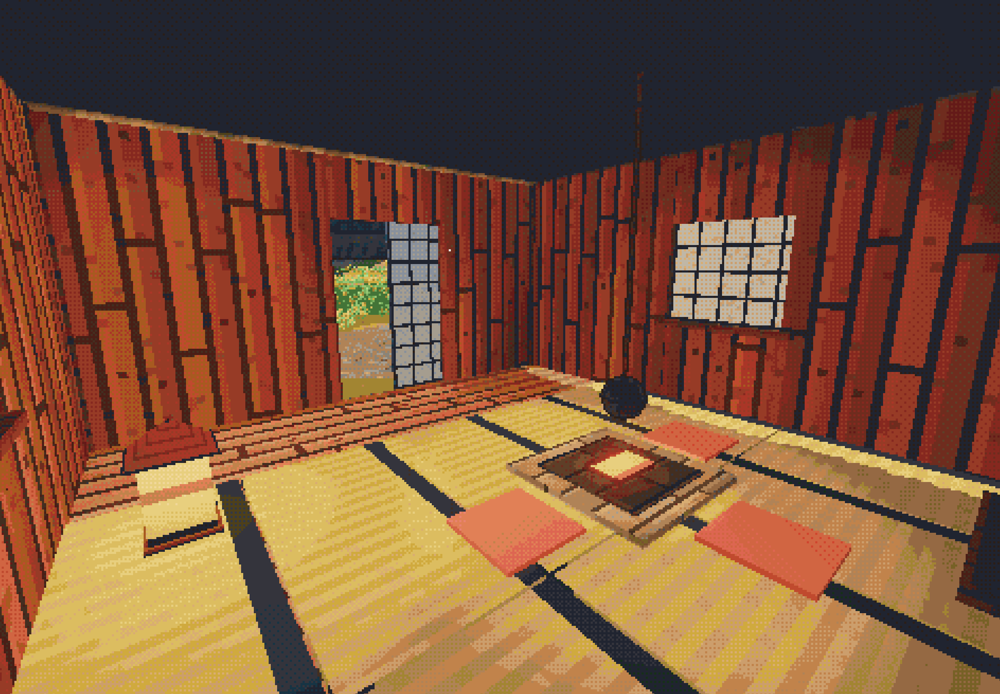 |  |
| **Ichiba at dusk** | **A village at night from the hills** |
| 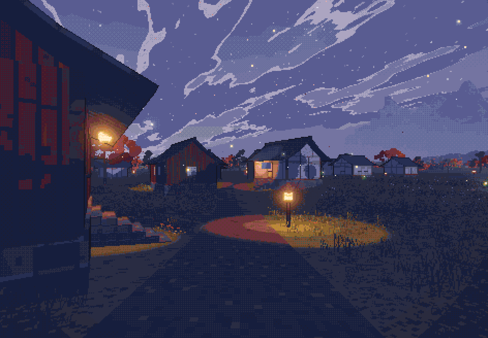 | 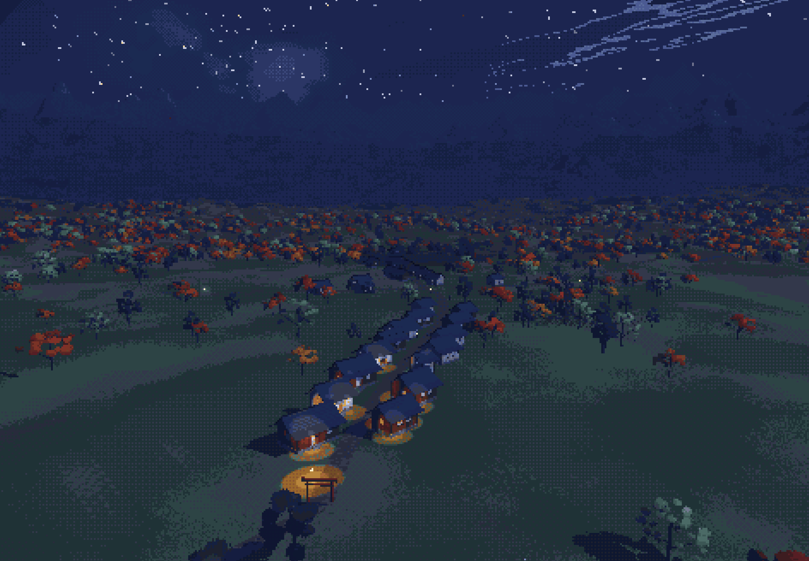 |
| **Inaho, thatched farmhouses** | **Shiomachi harbour** |
|  |  |

| Check | Result |
|---|---|
| Unit tests | ✅ 45 passed (layout determinism, no overlaps, every house has a door gap, floor and walkable steps, roads connect) |
| Houses e2e (`npm run e2e:houses`) | ✅ walk up, door opens, step inside (indoors, room reverb, tatami steps), walls hold |
| Offline · stability · controls · audio e2e | ✅ |
| Draw calls · triangles (Medium) | benchmark path 311 · 1.57 M; market street at dusk 360 · 1.33 M; inside a house 244 · 0.64 M |

### M13 at a glance (audio)

Everything you hear is synthesised in the browser: no sound files.

- **Music** comes now and then, like in Minecraft: a generated piece of 2–4 minutes, then long
  stretches of just the world. Koto, shakuhachi, shamisen, soft piano, music box, pads and bells
  on Japanese scales. Each region has its own motif, and the Lantern Lake theme comes back in
  variations.
- **Ambience** follows the place, the hour and the wind:
  - dawn chorus in the woods (bush warbler, tits, doves, woodpeckers)
  - creaking cedars, dripping leaves and bamboo knocks in the deep forests
  - crickets, bell crickets, frogs and owls at night
  - gulls and surf at the coast
  - a wind chime at the dock, the temple bell at 6 and 18 h
- **Sound is placed in 3D** around your head, with reverb that changes between forest, valley
  and open land.
- **Footsteps** change with the ground: grass, dry leaves, wood boards, gravel, sand, snow and
  shallow water.
- **Settings → Sound** has volume sliders and how often music plays (often / occasional /
  rare / off).

Listen (rendered offline from the game's own synths):
[main theme](docs/audio/main-theme-title.wav) ·
[cedar forest](docs/audio/cedar-forest-day.wav) ·
[rice valley](docs/audio/rice-valley-day.wav) ·
[lake at night](docs/audio/lake-night.wav)

| Check | Result |
|---|---|
| Unit tests | ✅ 41 passed (composer: determinism, 2–4 min arcs, notes in scale, main theme, sparse nights) |
| Audio e2e (`npm run e2e:audio`) | ✅ unlock on first tap, real output level, music plays, and each of 6 places gets its own mix (forest reverb, surf at the coast, dawn chorus, night insects/frogs, bamboo) |


### M5 at a glance

Grass everywhere: 16 kinds of ground plants (tufts, tall grass, reeds, cattails, ferns, moss,
sasa, pampas, rice, clover, cosmos, spider lilies, bellflowers, dandelions, daisies, horsetail)
stream around you in one draw call, bend in the wind and part as you walk through. Nine new
trees and bushes (willow, persimmon, camphor, hinoki, plum, zelkova, azalea, hydrangea,
camellia), twice-as-dense cedar and bamboo woods, ground mist, and ambient particles —
fireflies, falling leaves, petals, pollen, sun motes, sea spray, moths, steam (rain and snow
are ready for the weather in M6).

| Misty cedar forest | Fireflies at the dock |
|---|---|
|  |  |
| **The pampas moor** | **Bamboo grove** |
| 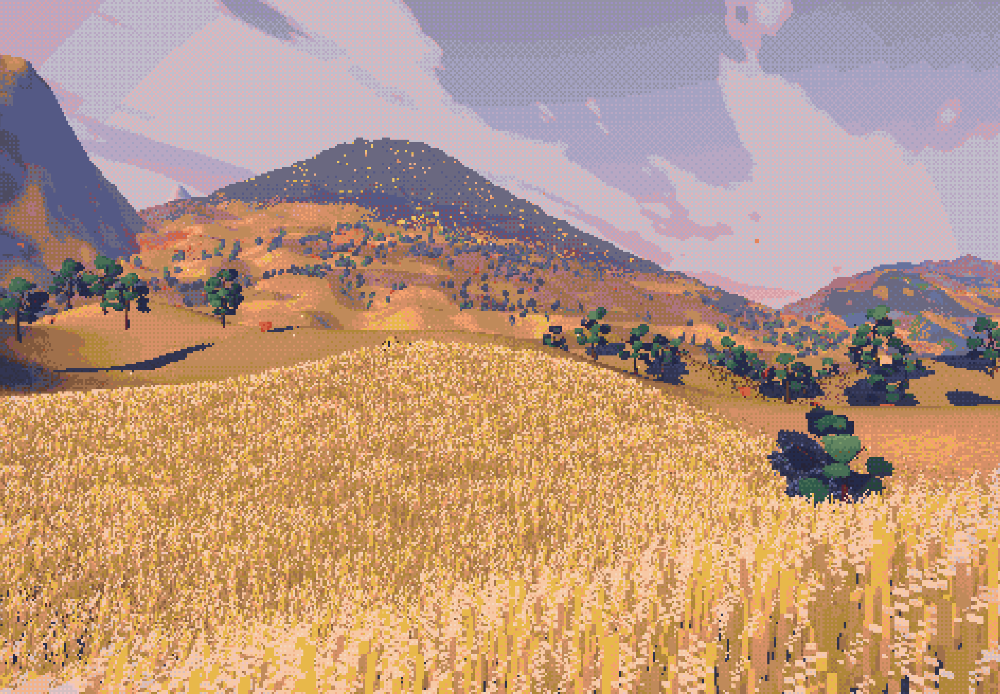 | 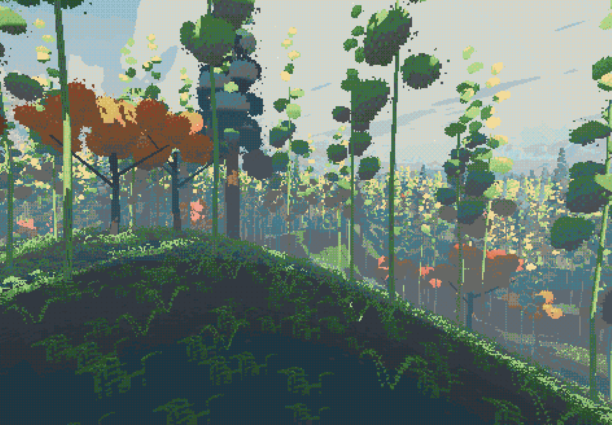 |
| **Meadow by the dock** | **Cosmos fields** |
|  |  |

| Check | Result |
|---|---|
| Unit tests | ✅ 36 passed (incl. ground-plant determinism and tile bounds) |
| Offline · pixel stability · controls e2e | ✅ · ✅ (one-pixel turn match 0.979) · ✅ |
| Draw calls · triangles (headless, all passes) | Low 251 · 1.23 M — Medium 303 · 1.59 M — High 360 · 1.93 M |

Medium is slightly over the 1.5 M triangle budget because of the denser forests; the iPad
benchmark decides whether the far-tree LOD needs trimming.

### M3 at a glance

Walk, jog, slow walk, jump, step up onto ledges, wade, swim (calm, no drowning), slide on snow,
sit and lie down anywhere, time-lapse while sitting, soft landings. Desktop, touch, gamepad and
**Apple Pencil** (tap = look there & interact, drag = precise look, pixel brush cursor);
every key rebindable; FOV, sensitivity, invert Y, head bob, tap-to-jog.

| On the pier (interact prompt) | Sitting at dusk |
|---|---|
|  | 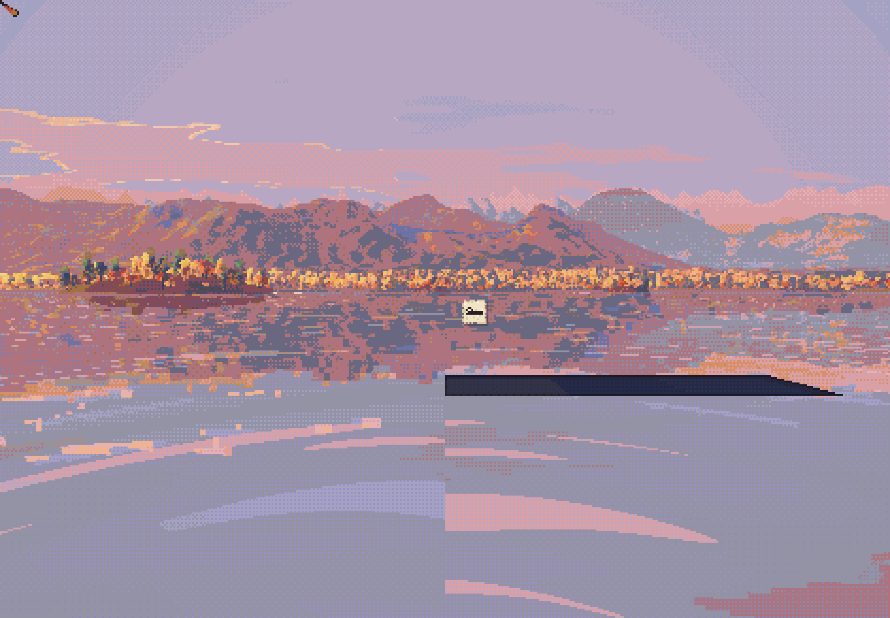 |
| **Swimming** | **Touch controls** |
|  | 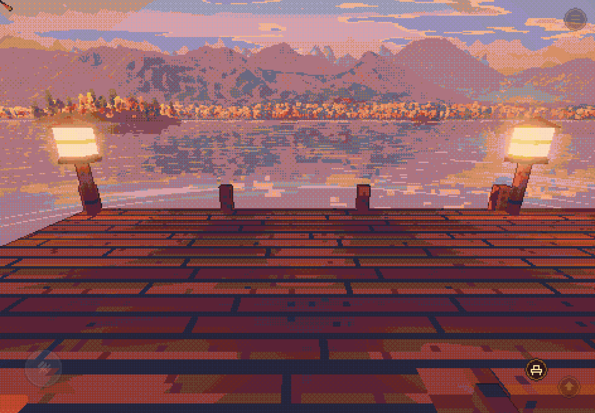 |

| Check | Result |
|---|---|
| Unit tests | ✅ 33 passed |
| Controls e2e (`npm run e2e:controls`) | ✅ walk, jump & land, swim, sit, time-lapse, stand up, colliders, Apple Pencil tap |
| Offline / pixel stability | ✅ / ✅ (one-pixel turn match 0.98 after the water-mesh fix) |
| Draw calls · triangles (Medium, all passes) | 278 · 1.54 M |

### M2 at a glance

A 10 km world (16 km with the border ranges) streamed around the player: 20 regions from
the spec, a quadtree terrain built in Web Workers, forests streamed in tiles, and only what
is visible gets drawn.

| Lantern Lake from the castle mountain | Mirror lake at dusk |
|---|---|
|  | 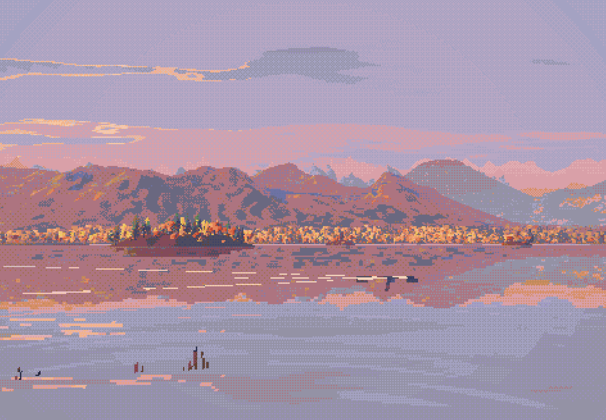 |
| **Maple mountains, golden hour** | **High over the world** |
| 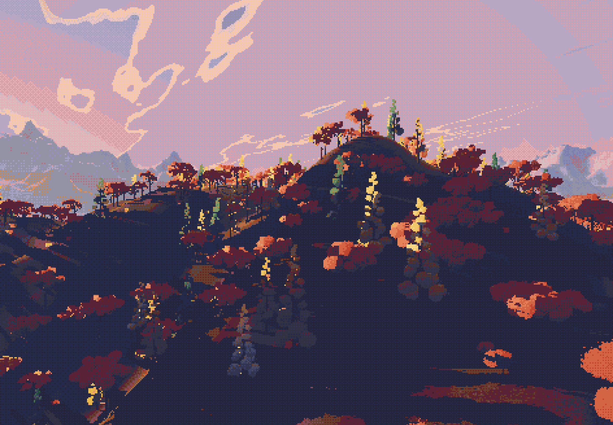 |  |

| Check | Result |
|---|---|
| Unit tests | ✅ 33 passed (incl. chunk-hash determinism, tree placement) |
| Offline boot + save load | ✅ |
| Pixel stability | ✅ |
| Draw calls (headless benchmark path, all passes) | Low 232 · Medium 278 · High 352 (budget < 400) |
| Triangles (all passes: shadow + reflection + main) | Low 1.22 M · Medium 1.54 M · High 1.91 M |
| Download size | 853 KB |
| iPad benchmark | ⏳ needs a run on the iPad |

### M1 at a glance

| Night dock (reference 1) | Mirror lake at dusk (reference 2) |
|---|---|
|  |  |
| **Title screen** | **On the pier (touch HUD)** |
|  |  |

M1 checks:

| Check | Result |
|---|---|
| Type-check + build | ✅ |
| Unit tests (`npm test`) | ✅ 29 passed |
| Offline boot + save load (`npm run e2e:offline`) | ✅ |
| Pixel stability (`npm run e2e:stability`) | ✅ sub-pixel turn: 0 changed pixels |
| Console errors in screenshot runs | ✅ none |
| Download size (precache) | 813 KB |
| Headless perf (software GL, regression only) | see below |
| iPad Air benchmark | ⏳ needs a run on the iPad |

Headless software-rendered numbers (SwiftShader, 2360×1640, *not* representative of a GPU):

| Preset | Internal res (1180×820 viewport) | Avg frame | 1 % low | Draw calls | Triangles (all passes) |
|---|---|---|---|---|---|
| Low | 394×274 ×3 | 789 ms | 883 ms | 101 | 855 k |
| Medium | 590×410 ×2 | 926 ms | 1017 ms | 101 | 855 k |
| High | 590×410 ×2 | 1086 ms | 1300 ms | 101 | 855 k |

Triangles and draw calls are the meaningful numbers here (budget: < 400 draws, < 1.5 M
triangles); frame times need the iPad run.

## Install on iPad (works offline)

1. One-time setup (repo owner): make the repository public, then
   *Settings → Pages → Source: GitHub Actions*. Every push to `main` deploys.
2. On the iPad, open **https://thetaminolutz.github.io/hotaru/** in Safari once.
3. Tap **Share → Add to Home Screen**.
4. Start Hotaru from the home screen. Everything is cached; airplane mode works.
   When a new version has been downloaded, a small paper toast offers a restart.

## Controls

| | Desktop | iPad (touch) | Apple Pencil | Gamepad |
|---|---|---|---|---|
| Look | click, then mouse | drag on the right side (any finger while the Pencil walks) | in "Pencil looks" mode: drag | right stick |
| Walk / jog / slow | WASD · Shift · Ctrl/C | koi stick (rim = jog, gentle = slow) | drag from where the Pencil touches down; press harder to jog | left stick · L3/RT · LB/LT |
| Jump | Space | jump token | — | A |
| Interact · sit · lie · stand | E | interact token | tap the thing (also turns your view) | X / B |
| Time-lapse (while sitting) | hold T | hold the hourglass token | — | hold Y |
| Journal · map · photo | J · M · P | book · map · camera tokens, top right | write on the map / album | Back · d-pad ↑ · d-pad ↓ |
| Use tool (lantern, rod, flute, umbrella) | F | tool token | — | RB |
| Row a boat | WASD (forward/back rows, left/right steers) | koi stick | — | left stick |
| Menu | Esc | lacquer token, top right | — | Start |
| Debug panel | `` ` `` | three-finger tap | — | — |

All keys can be rebound in Settings → Keys. In photo mode Q / E roll the camera.

**Apple Pencil + thumb:** with *Settings → Comfort → Pencil walks* on (the default), the Pencil
is a floating walking stick: touch down anywhere and drag the way you want to go, pressing
harder to jog, while your thumb or any finger looks around. A quick Pencil tap still turns
toward something and uses it, and Pencil taps on the tokens work like a finger.

## Settings

- **Graphics:** quality preset (Low / Medium / High), auto quality, frame cap (30 / 60 /
  none), dithering, outlines, FPS counter.
  - Auto quality steps down one preset while frames stay slow, and back up when there's
    room again.
- **Camera:** field of view, look sensitivity, invert Y, head bob, tap-to-jog.
- **Sound:** master, music, nature & places, and footsteps & UI volumes; how often music
  plays.
- **World:** seasons cycling (3, 7 or 14 days each) or locked to one season; changing or
  always-fair weather.
- **Comfort:** reduced motion, large text, high-contrast text, subtitles for the sounds
  around you, mono sound, left-handed touch layout, villager hints.
  - Reduced motion means no head bob and no lightning flashes.
- **Keys:** every action can be rebound.
- **Saves:** three slots, plus export and import as a file.

## Saving

Hotaru saves on its own: every minute, when you open the menu, when you sleep, and when
the iPad switches away from the app.
- Each save is written with an atomic swap (temp key, then the real key).
- The previous save is kept as a backup, so a broken save falls back to the one before it.
- Saves live in IndexedDB. Ask Safari to keep them (the game requests persistent
  storage), and use **Settings → Saves → Export save** now and then to keep a copy.
- Photos and sketches are stored in the save.
- **New Journey** asks once before it replaces the slot's save.

## Benchmark on the iPad

Open the debug panel (three-finger tap) → **Benchmark (current preset)** (60 s) or
**All presets** (3 min). Copy the result line and paste it back; it goes into the table above.

## Development

```sh
npm ci
npm run dev            # http://localhost:5173  (?debug=1 opens the debug panel)
npm test               # unit tests (Vitest)
npm run build          # production build + service worker in dist/
npm run shots -- M5    # milestone screenshots → docs/screenshots/M5/
npm run e2e:offline    # offline boot test (builds must exist)
npm run e2e:stability  # pixel stability test
npm run e2e:controls   # walking, swimming, sitting, Pencil tap
npm run e2e:audio      # audio unlock, output and per-place mix
npm run e2e:houses     # walk into a house
npm run e2e:fauna      # animals: presence, fleeing, petting, bowing
npm run e2e:water      # swim in a river, ripples
npm run e2e:people     # villagers through a day, lantern round, talking
npm run e2e:secrets    # shrines, viewpoints, tablets, caves, the keep
npm run e2e:items      # keepsakes, gifts, fishing, rowing, journal, map, photos
npm run e2e:story      # festivals, the ending, kodama, dreams, 100+ secrets
npm run e2e:release    # save backup, auto quality, hints, comfort settings
node scripts/perf.mjs  # headless benchmark (all presets)
node scripts/perf-breakdown.mjs  # triangles & draws per pass and per group
npm run audio:samples  # render music samples → docs/audio/
npm run icons          # regenerate app icons & launch images
```

Useful URL parameters: `?shot=dock-night|lake-dusk|dock-golden|dock-day|lake-night|pier-end`,
`?t=17.5` (hour), `?ui=gallery` (every UI element), `?quality=low|medium|high`,
`?off=bloom,quantize,outlines,reflections,shadows,grade,vignette`, `?seed=123`, `?play=1`.
